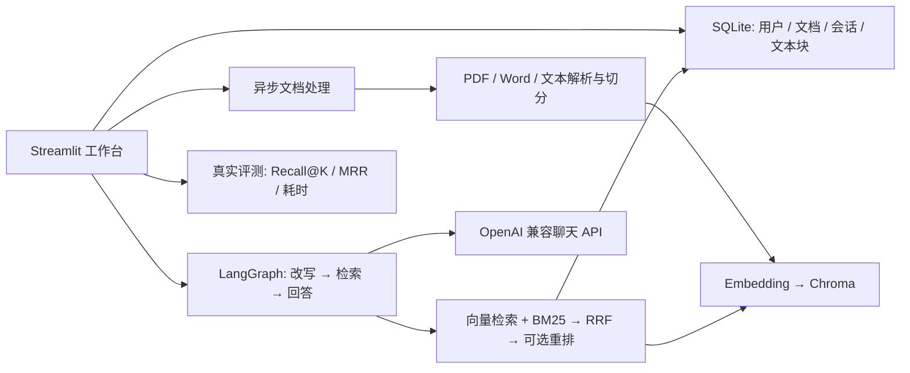

# Atlas RAG Knowledge Hub

> 基于 LangChain、LangGraph 和 RAG 的知识库问答与论文研读演示项目。**本仓库只包含源码与合成示例，不包含用户论文、数据库、向量索引或 API Key。**


## 项目能做什么

- **企业 / 论文知识库**：账号隔离；PDF、DOCX、TXT、Markdown、CSV 上传；处理状态、重试、版本更新和索引删除，最大文件 100 MB。
- **有出处的问答**：向量语义检索 + BM25、RRF 倒数排名融合、可选 LLM 候选重排，引用原文和 PDF 页码。
- **多轮对话**：同库会话隔离，近期窗口、较早对话摘要、按需 Query Rewrite，SQLite 持久化。
- **论文分析**：六类预设研读任务，单篇分析与多篇对比；中文提问英文论文时补充英文检索词和论文段落覆盖。
- **效果评测**：使用自己标注的 JSON 问题集，实际比较纯向量、混合检索和重排模式的文档级 Recall@K、MRR 与耗时。

**不是通用自主 Agent**：LangGraph 负责“改写 → 检索 → 回答”工作流。没有训练新模型、没有生产级多租户审计、没有 MySQL/Redis/Celery。当前增量输出由 Streamlit 连接承载，并非 HTTP SSE。

## 架构



`RRF`（Reciprocal Rank Fusion）不直接相加两种不同量纲的分数，而是按每个结果在各路检索中的名次求和：`score(d) = Σ 1 / (60 + rank_i(d))`；同时被两路排到前面的证据通常更靠前。实现在 `src/modules/retrieval.py`。

## 在另一台电脑运行

要求 Python **3.11+**，先用 Git 克隆本仓库：

```bash
git clone https://github.com/shilaoshitou-ux/rag-knowledge-hub.git
cd rag-knowledge-hub
python -m venv .venv
```

Windows PowerShell：

```powershell
.\.venv\Scripts\python.exe -m pip install -r requirements.txt
.\start-rag.ps1
```

Linux / macOS：

```bash
.venv/bin/python -m pip install -r requirements.txt
.venv/bin/python -m streamlit run src/asgi_app.py --server.address=127.0.0.1 --server.port=8507
```

浏览器访问 **http://localhost:8507/**。首次启动数据库会自动创建；注册自己的账号，在侧栏选择模型服务，填入**你自己的**聊天/向量模型权限对应的 Key。默认服务现为一个 OpenAI 兼容接口；也能选 OpenAI 或自定义兼容 HTTPS 接口；模型目录不保证你的 Key 有权限。公司 Key、用户私有资料和 DPAPI 本机密钥**都不会随 Git 克隆**，换电脑必须重新配置；两台机器的数据库也不会自动同步。公开演示请勿上传敏感材料。

在“我的知识库”创建企业库或论文库，上传文件并等状态变成“处理成功”；到“AI 智能问答”选库和新会话提问。可以先上传 `examples/rag-demo.txt`（明确为**合成**测试资料），再问“项目负责人是谁？”；无可用聊天/向量 Key 时不能伪造模型回答。本地向量化可另外安装 `requirements-local.txt` 并运行 Ollama；问答依然需要聊天模型服务。

## Docker / 公网演示

```bash
docker compose up --build -d
```

Docker Compose 将资料保存在独立的 `rag_data` 卷，并只映射本机 `127.0.0.1:8507`。容器内没有 Windows DPAPI，网页上的 Key 不能持久保存；请在每次会话填写，不要把真实 Key 放进仓库或共享环境变量。**GitHub 仓库不是可运行的网站，localhost 也只有本机能访问。**如需给面试官直接打开网页，须额外部署运行服务，保留持久磁盘，并承担托管和模型费用。步骤、安全边界及可选 Render Blueprint 见 [DEPLOYMENT.md](DEPLOYMENT.md)；本仓库不包含已部署的在线演示，也不声称 Render Blueprint 已验证上线。

## 自己复现评测

`examples/eval-demo.json` 仅供学习格式：先把合成资料 `rag-demo.txt` 上传并处理成功，再上传这个问题集。JSON 每项要求 `question` 和已上传**完整文件名**列表 `relevant_documents`，可选 `expected_answer`。页面每轮允许 1–20 道题；结果可下载 JSON。文档级 Recall@K 不足以测量“是否找到方法章节”，这一类问题还应人工核对页码与片段；字符串包含率不等于答案准确率，模型裁判亦不能代替人工标注。本仓库**没有**已发布的大规模正式 Benchmark，也没有虚构的准确率提升数据。

```bash
python -m unittest discover -s tests -q
python -m compileall -q src tests
python -m pip check
```

单机测试使用临时库、FakeEmbeddings 和模拟接口；需自行提供合法 Key 才能测试真实网关生成。已知限制：扫描版 PDF 无 OCR；无页面图像高亮；Rerank 是聊天模型排序而非专用 CrossEncoder；异步任务为本机线程池而非分布式队列；尚无公网安全审计、SSO、登录限流。**不建议不加访问控制直接给陌生人开放注册和文档上传。**

## 目录

- `src/app_pages/`：工作台、问答、知识库、论文、历史、评测与设置。
- `src/modules/managed_index.py`：上传队列、索引生命周期。
- `src/modules/retrieval.py`、`src/modules/paper_evidence.py`：融合检索与论文证据覆盖。
- `src/modules/workflow.py`、`src/modules/chatbot.py`：多轮工作流与证据约束生成。
- `src/modules/repository.py`：SQLite 权限边界、数据迁移和会话。
- `tests/`：回归测试；`examples/`：合成测试文件。

## 来源与许可证

本项目在 [yvann-ba/Robby-chatbot](https://github.com/yvann-ba/Robby-chatbot) 基础上渐进改造，保留原项目代码及 [Apache License 2.0](LICENSE) 与归属说明；新功能属于二次开发。发现安全问题请参阅 [SECURITY.md](SECURITY.md)。