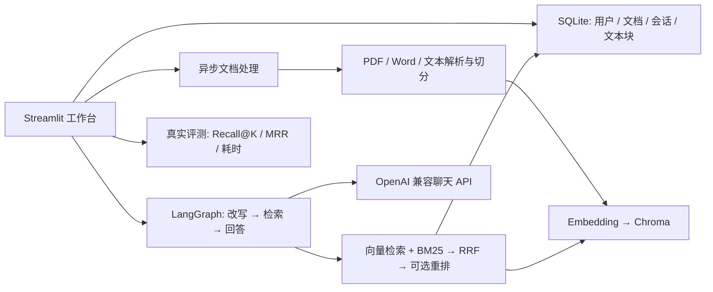

# Atlas RAG Knowledge Hub

> 基于 LangChain、LangGraph 和 RAG 的知识库问答与论文研读演示项目。**本仓库只包含源码与合成示例，不包含用户论文、数据库、向量索引或 API Key。**


## 界面预览

以下图片来自**隔离的合成演示账号**，未使用个人论文、真实账号或 API Key；截图中的 0 个文档、0 次模型回答是实际页面状态，不代表模型效果。


## 项目能做什么

- **产品化界面**：深色侧边导航、响应式工作台、卡片式知识库与带引用的对话区；仪表数据来自当前账号真实状态。
- **企业 / 论文知识库**：账号隔离；PDF、DOCX、TXT、Markdown、CSV 上传；处理状态、重试、版本更新和索引删除，最大文件 100 MB。
- **有出处的问答**：向量语义检索 + BM25、RRF 倒数排名融合、可选 LLM 候选重排，引用原文和 PDF 页码。
- **多轮对话**：同库会话隔离，近期窗口、较早对话摘要、按需 Query Rewrite，SQLite 持久化。
- **论文分析**：六类预设研读任务，单篇分析与多篇对比；中文提问英文论文时补充英文检索词和论文段落覆盖。
- **效果评测**：使用自己标注的 JSON 问题集，实际比较纯向量、混合检索和重排模式的文档级 Recall@K、MRR 与耗时。

**不是通用自主 Agent**：LangGraph 负责“改写 → 检索 → 回答”工作流。没有训练新模型、没有生产级多租户审计、没有 MySQL/Redis/Celery。当前增量输出由 Streamlit 连接承载，并非 HTTP SSE。

## 从零开始使用

### 1. 下载并启动

需要 **Python 3.11+** 和 Git。克隆到自己的电脑后，在项目根目录执行：

```bash
git clone https://github.com/shilaoshitou-ux/rag-knowledge-hub.git
cd rag-knowledge-hub
python -m venv .venv
```

**Windows PowerShell**：

```powershell
.\.venv\Scripts\python.exe -m pip install -r requirements.txt
.\start-rag.ps1
```

**Linux / macOS**：

```bash
.venv/bin/python -m pip install -r requirements.txt
.venv/bin/python -m streamlit run src/asgi_app.py --server.address=127.0.0.1 --server.port=8507
```

看到服务启动后，在**运行它的电脑**打开 <http://localhost:8507/>。不要直接运行 `src/Home.py`：`src/asgi_app.py` 才包含刷新后保持登录所需的认证路由。停止终端进程也会停止网页服务。首次启动会创建自己的空数据库；GitHub 不包含任何用户账号、PDF、向量索引或密钥。

### 2. 注册自己的账号

登录页切换到「注册」，填写用户名和至少 10 位密码，创建后切回「登录」。截图中的 `atlas_demo` 仅存在于隔离的截图测试库，**不是仓库预设账号**。


### 3. 配置聊天模型与向量模型

登录后展开左侧「**模型连接与密钥**」：

1. 选择「默认服务」「OpenAI」或「自定义接口」；自定义地址应是你**可以访问**的 OpenAI 兼容 HTTPS Base URL。
2. 选择有权限的**问答模型**；目录只是候选，实际可用性取决于你的服务和 Key。
3. 选择「在线 API」或「本地 Ollama」向量化，并选择对应的**向量模型**。在线向量化也需要当前接口的有效 Key。
4. 填入你自己的 API Key。企业网关若只在内网可访问，外部电脑或云服务器可能无法连通；可以换成自己有权限的模型服务。

**密钥不会放进 GitHub。**Windows 的「保存到本机」使用当前 Windows 用户的 DPAPI；Linux / Docker 上不能使用此保存方式，可在当前会话临时输入，刷新或重启后可能需要重新输入。公开实例不要输入未经授权的公司 Key。若选择本地 Ollama 向量化，还需安装 `requirements-local.txt`、在运行应用的电脑启动 Ollama 并准备对应向量模型；聊天问答仍需可用的聊天模型服务。

### 4. 创建知识库并上传文档

进入「**我的知识库**」→「创建新知识库」，按用途选「企业知识库」或「学术论文库」，填写名称后创建。向量模型和服务地址会绑定到该库；后续处理和问答请使用与建库时相同的接口。两个类型的资料分别管理，不会混入同一次检索。


在目标卡片点「**管理资料**」→「**选择文件**」；等上传框显示文件名与大小，再点「**上传并处理**」。**只选中文件不等于已上传处理。**支持 PDF、DOCX、TXT、Markdown、CSV，单文件上限 100 MB；扫描版 PDF 需要先 OCR。状态会显示「等待处理 / 处理中 / 处理成功 / 处理失败」，失败可在文档列表查看错误并重试；**只有处理成功才可用于检索问答**。


> 本图刻意未填测试 Key，因此页面显示「尚未检测到 API 密钥」；这不是一次上传成功的截图。你可以先用仓库里的**合成**文件 [`examples/rag-demo.txt`](examples/rag-demo.txt) 试跑，不要将私人文档提交到仓库。

### 5. 基于文档提问与核对来源

进入「**AI 智能问答**」，选择刚处理成功的知识库，点「**新建会话**」并输入问题。合成示例可问「项目负责人是谁？」。回答生成后展开「**查看引用来源**」，点击引用核对原文、片段和可用的 PDF 页码；历史会话可继续讨论。左侧「检索与对话偏好」可切换纯向量、BM25 + 向量融合或模型重排（重排可能增加调用费用）。


> 本图是未配置 Key、未上传文档时的真实空状态，**没有伪造模型回答**。要完成一次真实问答，必须先让文档处理成功，并使用支持问答和向量化的模型服务。

#### 让总结回答更完整

在 AI 智能问答中，选对知识库后，可以问「请总结这份项目记录的背景、我实际做的工作、排查步骤、验证结果和局限，并分别引用原文」。对「总结我在某项目做的问题」这类宽泛问题，系统会自动从背景、实施、结果等角度检索，默认最多给模型约 10 条去重证据；「检索与对话偏好」可把引用片段数调至 10–12 条，或调到 1–5 条获得更精简的回答。检索更多片段可能增加响应时间和模型费用。

如果上传的资料只有章节标题，没有问题原因、具体解决步骤或验证数据，助手仍只能说明**原文未提供**，不会靠拉长字数编造经历。要改善效果，请上传可提取文字的正文、排查记录和可公开的结果材料；生成后展开「查看引用来源」逐条核对。旧回答不会自动改变，可以点「重新生成最后一条回答」或换一个更明确的问题再试。

### 6. 论文分析与效果评测

- **论文智能分析**：先创建「学术论文库」并上传 PDF，处理成功后到「论文智能分析」选择库和论文，可进行单篇精读或 2–5 篇论文对比；结果应结合引用原文复核。
- **RAG 效果评测**：先处理好文档，再按 [`examples/eval-demo.json`](examples/eval-demo.json) 准备问题集，在「RAG 效果评测」上传 JSON，实际运行三种检索方案并查看 Recall@K、MRR、耗时等指标。合成问题集只是格式示例，不是预先计算好的成绩。

### 常见问题

| 现象 | 先检查什么 |
| --- | --- |
| 打不开 `localhost:8507` | 启动命令是否仍在运行、8507 是否被其他程序占用；这个地址只在运行项目的电脑上有效。 |
| 刷新后需要重新登录 | 是否从 `src/asgi_app.py` 启动；是否允许 Cookie；公网 HTTPS 反向代理需正确设置 `RAG_PUBLIC_ORIGIN`。 |
| 点「上传并处理」后没有可问答文档 | 看「已上传文档」中的等待、处理或失败状态；检查 Key、向量模型权限、网络和建库时绑定的服务地址。 |
| Key 保存按钮不可用 | DPAPI 保存仅支持 Windows；Linux / Docker 请按会话临时输入，不要将 Key 提交到 GitHub。 |
| PDF 处理成功但提取不到内容 | 确认是不是扫描版 PDF；目前没有内置 OCR，需要先转为可提取文本。 |

## 架构



`RRF`（Reciprocal Rank Fusion）不直接相加两种不同量纲的分数，而是按每个结果在各路检索中的名次求和：`score(d) = Σ 1 / (60 + rank_i(d))`；同时被两路排到前面的证据通常更靠前。实现在 `src/modules/retrieval.py`。

## Docker / 公网演示

```bash
docker compose up --build -d
```

Docker Compose 将资料保存在独立的 `rag_data` 卷，并只映射本机 `127.0.0.1:8507`。容器内没有 Windows DPAPI，网页上的 Key 不能持久保存；请在每次会话填写，不要把真实 Key 放进仓库或共享环境变量。**GitHub 仓库不是可运行的网站，localhost 也只有本机能访问。**如需给面试官直接打开网页，须额外部署运行服务，保留持久磁盘，并承担托管和模型费用。步骤、安全边界及可选 Render Blueprint 见 [DEPLOYMENT.md](DEPLOYMENT.md)；本仓库不包含已部署的在线演示，也不声称 Render Blueprint 已验证上线。

## 自己复现评测

`examples/eval-demo.json` 仅供学习格式：先把合成资料 `rag-demo.txt` 上传并处理成功，再上传这个问题集。JSON 每项要求 `question` 和已上传**完整文件名**列表 `relevant_documents`，可选 `expected_answer`。页面每轮允许 1–20 道题；结果可下载 JSON。文档级 Recall@K 不足以测量“是否找到方法章节”，这一类问题还应人工核对页码与片段；字符串包含率不等于答案准确率，模型裁判亦不能代替人工标注。本仓库**没有**已发布的大规模正式 Benchmark，也没有虚构的准确率提升数据。

```bash
python -m unittest discover -s tests -q
python -m compileall -q src tests
python -m pip check
```

单机测试使用临时库、FakeEmbeddings 和模拟接口；需自行提供合法 Key 才能测试真实网关生成。已知限制：扫描版 PDF 无 OCR；无页面图像高亮；Rerank 是聊天模型排序而非专用 CrossEncoder；异步任务为本机线程池而非分布式队列；尚无公网安全审计、SSO、登录限流。**不建议不加访问控制直接给陌生人开放注册和文档上传。**

## 目录

- `src/assets/`：品牌 SVG 标识（静态资源）。
- `src/app_pages/`：工作台、问答、知识库、论文、历史、评测与设置。
- `src/modules/managed_index.py`：上传队列、索引生命周期。
- `src/modules/retrieval.py`、`src/modules/paper_evidence.py`：融合检索与论文证据覆盖。
- `src/modules/workflow.py`、`src/modules/chatbot.py`：多轮工作流与证据约束生成。
- `src/modules/repository.py`：SQLite 权限边界、数据迁移和会话。
- `tests/`：回归测试；`examples/`：合成测试文件。

## 开源致谢与许可

本仓库实现了账号隔离知识库、混合检索与引用、多轮会话、论文分析、效果评测和新版工作区界面。项目保留了 [Robby-chatbot](https://github.com/yvann-ba/Robby-chatbot) 的部分早期功能代码及其 [Apache License 2.0](LICENSE) 许可，感谢原项目作者的开源贡献。安全反馈请参阅 [SECURITY.md](SECURITY.md)。
