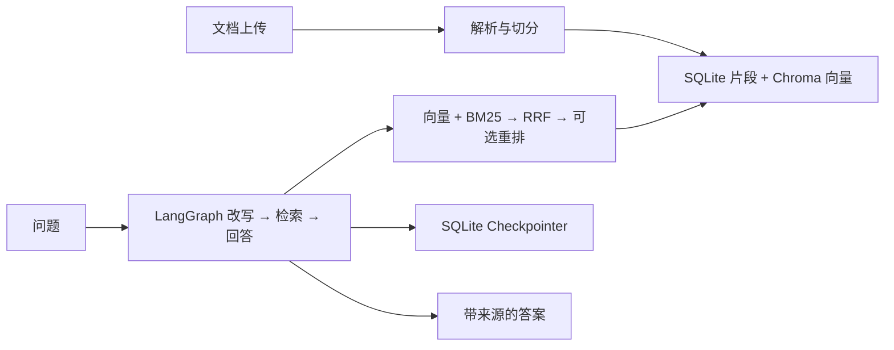

# Atlas RAG Knowledge Hub

> 基于 LangChain、LangGraph 与 RAG 的知识库问答、论文研读演示项目。支持按片段维护知识，而不必每次重传整篇文档。

[](https://github.com/shilaoshitou-ux/rag-knowledge-hub/actions/workflows/ci.yml)

## 核心功能

- **管理知识库**：账号隔离；上传 PDF、DOCX、TXT、MD、CSV；处理失败可重试，支持整篇更新和片段级修改/删除。
- **检索问答**：向量检索 + BM25，经 RRF 融合；可选 LLM Rerank，失败时提示并回退 Hybrid；回答展示引用来源。
- **多轮与恢复**：SQLite 保存会话与历史；LangGraph Checkpointer 保存节点进度，中断后可手动继续。可选同库跨会话个人记忆。
- **论文与评测**：论文研读/多篇对比；通过人工标注题集比较文档级、片段级 Recall@K / MRR 和检索耗时。
- **索引维护**：SQLite 记录有效片段，Chroma 保存向量；清理失败可重试，并提供手动索引对账和修复。

## 界面预览

以下截图来自隔离的合成演示环境，不包含私人文档或虚构的模型回答。


## 本机运行

需要 Python 3.11+ 和 Git。克隆后进入项目目录：

```bash
git clone https://github.com/shilaoshitou-ux/rag-knowledge-hub.git
cd rag-knowledge-hub
python -m venv .venv
```

Windows PowerShell：

```powershell
.\.venv\Scripts\python.exe -m pip install -r requirements.txt
.\start-rag.ps1
```

Linux / macOS：

```bash
.venv/bin/python -m pip install -r requirements.txt
.venv/bin/python -m streamlit run src/asgi_app.py --server.address=127.0.0.1 --server.port=8507
```

打开 <http://localhost:8507/>，**先注册本机账号**，再配置你有权限的聊天模型与在线 Embeddings；也可选本地 Ollama 向量化（需额外安装 [`requirements-local.txt`](requirements-local.txt) 并准备模型）。创建知识库，上传合成示例 [`examples/rag-demo.txt`](examples/rag-demo.txt)，待处理成功后提问「项目负责人是谁？」。真实问答需要可用的模型服务和密钥；GitHub 仓库本身不是在线演示站点。

## 技术链路



**边界**：这是固定节点的 RAG 工作流，不是模型自主规划/调用工具的通用 Agent。片段修改不会改写上传的原件；SQLite 与 Chroma 不是跨库原子事务，索引补偿需手动触发。尚无可公开复现的真实模型效果提升数字，演示题集不是实测成绩。仅适合本机/受控环境展示，不建议未经安全加固开放公网注册和上传。

## 验证与更多说明

- 离线回归：`python -m unittest discover -s tests -q`（当前 124 项）；[GitHub Actions](https://github.com/shilaoshitou-ux/rag-knowledge-hub/actions/workflows/ci.yml) 会执行测试、编译和依赖检查。
- 标注题集与评测步骤：[`examples/evaluation/README.md`](examples/evaluation/README.md)。部署与安全边界：[DEPLOYMENT.md](DEPLOYMENT.md)、[SECURITY.md](SECURITY.md)。请勿提交 `.env`、真实资料、数据库或密钥。
- 项目保留了 [Robby-chatbot](https://github.com/yvann-ba/Robby-chatbot) 的部分早期代码及其 [Apache-2.0 许可](LICENSE)，感谢原作者的开源贡献。
