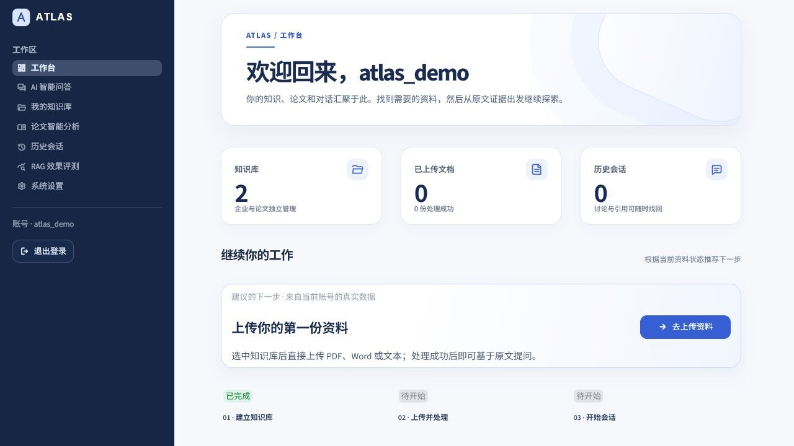
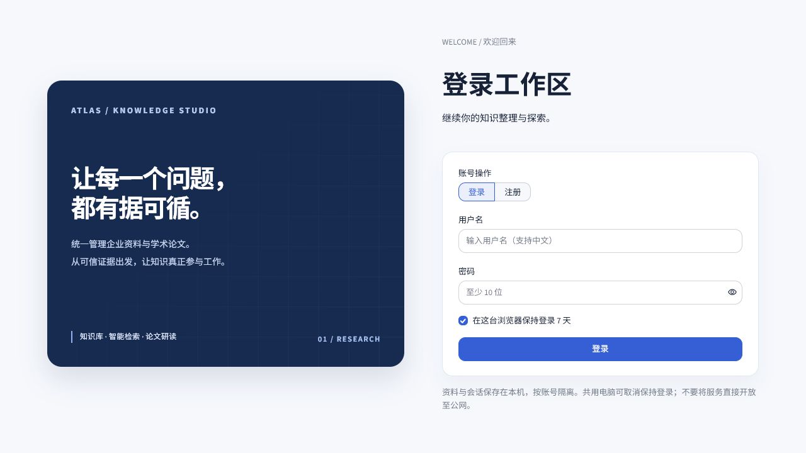
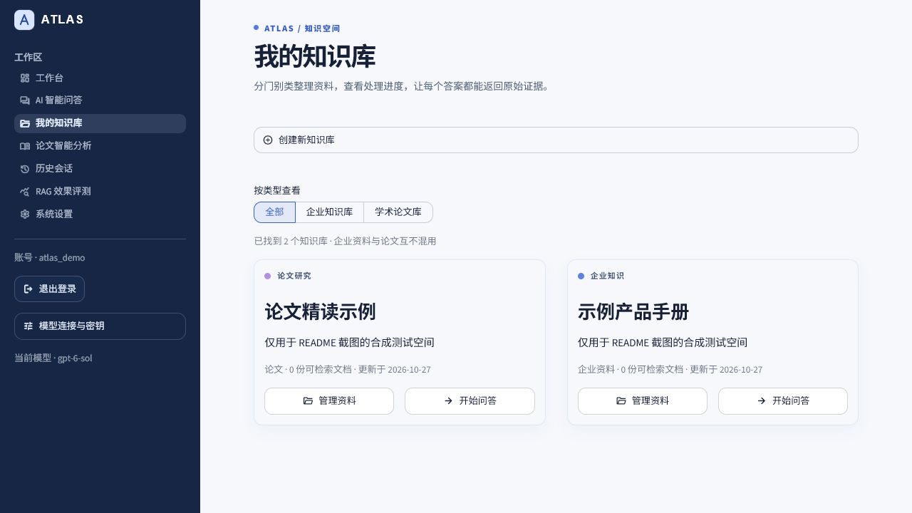
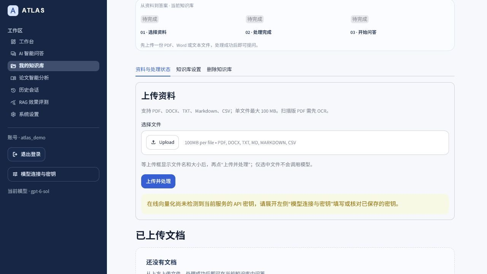
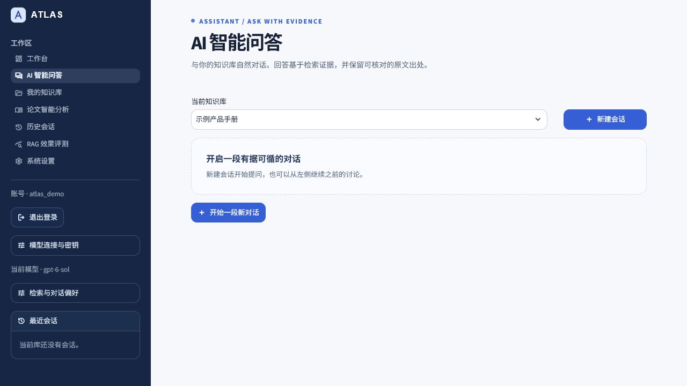
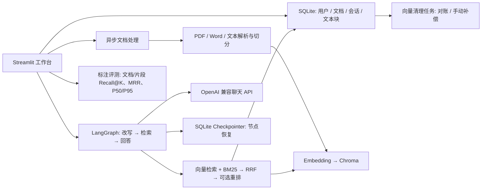

# Atlas RAG Knowledge Hub

> 基于 LangChain、LangGraph 和 RAG 的知识库问答与论文研读演示项目。**本仓库只包含源码与合成示例，不包含用户论文、数据库、向量索引或 API Key。**


## 界面预览

以下截图使用**隔离的合成演示账号**重新拍摄：2 个演示知识库、0 份文档、0 次会话，均是截图环境中的真实状态。没有使用个人论文、真实账号或 API Key，也没有用模拟回答冒充模型效果。



## 项目能做什么

- **产品化界面**：深色侧边导航、响应式工作台、按真实数据推荐的下一步、选中知识库优先展示上传区、无文档时明确引导的对话页；仪表数据来自当前账号真实状态。
- **企业 / 论文知识库**：账号隔离；PDF、DOCX、TXT、Markdown、CSV 上传；处理状态、重试和整篇版本更新。支持按片段修改或删除，无需重传整份文件，最大文件 100 MB。
- **有出处的问答**：向量语义检索 + BM25、RRF 倒数排名融合、可选 LLM 候选重排；重排失败回退 Hybrid 并提示。引用片段和 PDF 页码，人工修订会单独标记，不伪称 PDF 原文。
- **多轮对话与中断恢复**：同库会话隔离，近期窗口、较早对话摘要、按需 Query Rewrite；LangGraph SQLite Checkpointer 保存节点状态，刷新/中断后可手动继续。可选同库跨会话个人记忆，SQLite 持久化、Chroma 独立向量索引。
- **论文分析**：六类预设研读任务，单篇分析与多篇对比；中文提问英文论文时补充英文检索词和论文段落覆盖。
- **效果评测与索引运维**：用自己标注的 JSON 题集比较三种检索策略，计算文档级/可选证据片段级 Recall@K、MRR、P50/P95 检索耗时；向量清理失败保留待重试任务，支持手动对账、清理和修复。

**不是通用自主 Agent**：LangGraph 负责“改写 → 检索 → 回答”固定工作流；并无模型自主选择工具/规划步骤的实现。没有训练新模型、没有生产级多租户审计、没有 MySQL/Redis/Celery。当前增量输出由 Streamlit 连接承载，并非 HTTP SSE。

## 从零开始使用

### 1. 下载并启动

需要 **Python 3.11+** 和 Git。克隆到自己的电脑后，在项目根目录执行：

```bash
git clone https://github.com/shilaoshitou-ux/rag-knowledge-hub.git
cd rag-knowledge-hub
python -m venv .venv
```

**Windows PowerShell**：

```powershell
.\.venv\Scripts\python.exe -m pip install -r requirements.txt
.\start-rag.ps1
```

**Linux / macOS**：

```bash
.venv/bin/python -m pip install -r requirements.txt
.venv/bin/python -m streamlit run src/asgi_app.py --server.address=127.0.0.1 --server.port=8507
```

看到服务启动后，在**运行它的电脑**打开 <http://localhost:8507/>。不要直接运行 `src/Home.py`：`src/asgi_app.py` 才包含刷新后保持登录所需的认证路由。停止终端进程也会停止网页服务。首次启动会创建自己的空数据库；GitHub 不包含任何用户账号、PDF、向量索引或密钥。

### 2. 注册自己的账号

登录页切换到「注册」，填写用户名和至少 10 位密码，创建后切回「登录」。截图中的 `atlas_demo` 仅存在于隔离的截图测试库，**不是仓库预设账号**。



### 3. 配置聊天模型与向量模型

登录后展开左侧「**模型连接与密钥**」：

1. 选择「默认服务」「OpenAI」或「自定义接口」；自定义地址应是你**可以访问**的 OpenAI 兼容 HTTPS Base URL。
2. 选择有权限的**问答模型**；目录只是候选，实际可用性取决于你的服务和 Key。
3. 选择「在线 API」或「本地 Ollama」向量化，并选择对应的**向量模型**。在线向量化也需要当前接口的有效 Key。
4. 填入你自己的 API Key。企业网关若只在内网可访问，外部电脑或云服务器可能无法连通；可以换成自己有权限的模型服务。

**密钥不会放进 GitHub。**Windows 的「保存到本机」使用当前 Windows 用户的 DPAPI；Linux / Docker 上不能使用此保存方式，可在当前会话临时输入，刷新或重启后可能需要重新输入。公开实例不要输入未经授权的公司 Key。若选择本地 Ollama 向量化，还需安装 `requirements-local.txt`、在运行应用的电脑启动 Ollama 并准备对应向量模型；聊天问答仍需可用的聊天模型服务。

### 4. 创建知识库并上传文档

首次使用时，工作台会按账号当前状态提示下一步。进入「**我的知识库**」→「创建新知识库」，按用途选「企业知识库」或「学术论文库」，填写名称后创建。向量模型和服务地址会绑定到该库；后续处理和问答请使用与建库时相同的接口。两个类型的资料分别管理，不会混入同一次检索。



新建后会直接选中该知识库，**上传工作区位于知识库卡片列表之前**，可看到「选择资料 → 处理完成 → 开始问答」的状态提示。管理已有知识库时在卡片点「**管理资料**」；在上方上传区点击「**选择文件**」，等上传框显示文件名与大小，再点「**上传并处理**」。**只选中文件不等于已上传处理。**支持 PDF、DOCX、TXT、Markdown、CSV，单文件上限 100 MB；扫描版 PDF 需要先 OCR。状态会显示「等待处理 / 处理中 / 处理成功 / 处理失败」，失败可在文档列表查看错误并重试；**只有处理成功才可用于检索问答**。



> 本图刻意未填测试 Key，因此页面显示「尚未检测到 API 密钥」；这不是一次上传成功的截图。你可以先用仓库里的**合成**文件 [`examples/rag-demo.txt`](examples/rag-demo.txt) 试跑，不要将私人文档提交到仓库。

#### 局部更新 / 删除片段（无需重传整篇）

在「我的知识库」选择已处理成功的文档，展开「编辑知识片段」，选择具体片段后修改或删除。修改时仅为新片段生成向量，再在 SQLite 中切换有效 chunk ID；删除只移除选中的片段，其他片段保持不变。最后一块不能单独删除，应使用「删除文档」。人工编辑**只修改知识库内容，不回写上传的原 PDF/Word/TXT**；修订引用会显示「知识库修订」，有重叠切分时应检查相邻片段。

SQLite 保存当前有效片段，Chroma 保存向量，二者不是一个原子事务。向量删除失败时记录持久化清理任务；「索引健康检查」可按当前库手动扫描多余/缺失向量、重试清理，并在确认向量调用费用后从 SQLite 有效片段修复缺失向量（每次最多 20 条）。正在建索引时禁止对账；这不是后台自动定时巡检。

### 5. 基于文档提问与核对来源

文档处理成功后，知识库页会提供「去问答」入口；也可以进入「**AI 智能问答**」，选择刚处理成功的知识库，点「**新建会话**」并输入问题。没有可检索文档、也没有已启用且可检索的个人记忆时，问答页会引导先上传，并暂时禁用新建会话。合成示例可问「项目负责人是谁？」。回答生成后展开「**查看引用来源**」，点击引用核对原文、片段和可用的 PDF 页码；历史会话可继续讨论。左侧「检索与对话偏好」可切换纯向量、BM25 + 向量融合或模型重排（重排可能增加调用费用）。



> 本图是未配置 Key、未上传文档时的真实空状态，**没有伪造模型回答**。要完成一次真实问答，必须先让文档处理成功，并使用支持问答和向量化的模型服务。

#### 问答中断如何恢复

一次提问由 LangGraph 固定执行「问题改写 → 检索 → 回答」。开始时记录待恢复问题与参数；已完成的节点由 SQLite Checkpointer 保存。刷新、停止或服务重启后，回原会话点击「从检查点继续」，可复用已完成的节点；如果回答节点尚未完成，会重新生成回答，**不是从上次的 token 接着写**。最终答案与待恢复记录在 SQLite 同一事务中提交；若知识库片段已变更，须放弃旧任务重新提问。模型网关是否停止计费不由本应用保证。

#### 让总结回答更完整

在 AI 智能问答中，选对知识库后，可以问「请总结这份项目记录的背景、我实际做的工作、排查步骤、验证结果和局限，并分别引用原文」。对「总结我在某项目做的问题」这类宽泛问题，系统会自动从背景、实施、结果等角度检索，默认最多给模型约 10 条去重证据；「检索与对话偏好」可把引用片段数调至 10–12 条，或调到 1–5 条获得更精简的回答。检索更多片段可能增加响应时间和模型费用。

如果上传的资料只有章节标题，没有问题原因、具体解决步骤或验证数据，助手仍只能说明**原文未提供**，不会靠拉长字数编造经历。要改善效果，请上传可提取文字的正文、排查记录和可公开的结果材料；生成后展开「查看引用来源」逐条核对。旧回答不会自动改变，可以点「重新生成最后一条回答」或换一个更明确的问题再试。

### 可选的回答风格画像 V2（人工确认）

在「AI 智能问答」选定知识库后，展开左侧「回答风格画像（需确认）」并打开开关。此功能**默认关闭**、按账号和知识库隔离，与下文的个人事实长期记忆是两条独立链路：它**不**将原话向量化，不额外调用模型。规则只检查**已完整保存的用户消息**中明确的表达偏好（例如「回答太短了」「再详细一点」「内容太少」），不从论文、AI 回答或点击行为猜测画像。

同一维度在近 30 天内最近 **3 条不同的已完成用户消息**一致时，侧栏才显示「候选」及这 3 条反馈证据。你可点击「确认应用」或「不采用」；拒绝后至少还需 3 条新反馈才会再次建议。**未经确认绝不会应用**；确认后只把服务端固定白名单里的语言/详略/排版说明传给当前知识库后续问答（跨会话有效），当前提问的明确要求优先，任何画像都不能替代 RAG 文档证据或来源引用。关闭开关会暂停观察与应用，但不删除已有数据；可单项移除或确认后清空。删除原会话会使依赖其消息的未确认候选失效，已确认偏好保留直到你手动删除或删除知识库。

此实现是**保守的显式反馈规则 + SQLite 确认工作流**，不是模型自动推断隐性用户画像；无法识别所有自然语言表达与矛盾需求。SQLite schema v3→v4 仅新增 style_settings、style_observations、style_proposals、style_profiles 四张表，原用户、文档、消息与 v1 长期记忆不清空。反馈摘要和已确认风格存在应用运行电脑的 SQLite 中，不要在聊天中输入敏感信息。测试用临时数据库/模拟模型，并未用真实网关评估答案质量。

### 6. 可选的跨会话长期记忆

打开「AI 智能问答」→左侧「长期记忆（可选）」；**默认关闭**，开启后同一账号、同一知识库下的不同会话可以读取你保存的目标、偏好和明确约束。你可以先手动写「我希望长期从事 Python 后端开发」并点击「保存这条记忆」，然后新建会话问「你还记得我的目标吗？」；也可以在对话中明确说出长期目标，完整回答结束后系统才会尝试自动筛选记忆。可在左侧查看原话、逐条确认删除。关掉开关仅停止读写，旧记忆仍留在本机，须手动删除；删掉原会话不会删除长期记忆，删除知识库会同步清理其记忆集合。

记忆只提取**当前用户原话**中明确、稳定、有用的片段，不提取模型回答或上传的文档；提取候选必须与原话逐字匹配、符合类别并达到重要度阈值，再写入与文档索引分开的 Chroma 集合。召回时再以当前账号和知识库的 SQLite 记录校验，只用于个人化上下文，不能当论文/企业资料证据引用。短期 8 轮窗口与较早对话摘要仍照常工作。当前版本**仅限同库跨会话，不跨知识库共享**，也不能自动解决互相矛盾的旧记忆。个人记忆在 schema v3 引入 memory_settings、personal_memories 表；原消息和文档不删除；风格画像使用上述 schema v4 迁移。在线 Embeddings 会收到记忆原话，额外产生聊天/向量模型费用。记录以明文保存在本地 SQLite/Chroma，明显的密钥、电话等会过滤，但不保证识别所有隐私，**不要输入敏感资料**。在线向量服务没有有效 Key，或本地 Ollama 尚未就绪时，无法新增可检索记忆；本地 Ollama 手动记忆不需要在线向量 Key。测试仅使用合成数据与 FakeEmbeddings，未宣称真实网关记忆效果。

### 7. 论文分析与效果评测

- **论文智能分析**：先创建「学术论文库」并上传 PDF，处理成功后到「论文智能分析」选择库和论文，可进行单篇精读或 2–5 篇论文对比；结果应结合引用原文复核。
- **RAG 效果评测**：先处理好文档，再按 [`examples/eval-demo.json`](examples/eval-demo.json) 准备问题集，在「RAG 效果评测」上传 JSON，实际运行三种检索方案并查看 Recall@K、MRR、耗时等指标。合成问题集只是格式示例，不是预先计算好的成绩。评测页可导出当前有效片段 ID 清单，人工为每题标注 `relevant_chunks`，再比较证据级指标；示例 CLI、三份完全虚构的文档与六道题见 [`examples/evaluation/README.md`](examples/evaluation/README.md)。

### 常见问题

| 现象 | 先检查什么 |
| --- | --- |
| 打不开 `localhost:8507` | 启动命令是否仍在运行、8507 是否被其他程序占用；这个地址只在运行项目的电脑上有效。 |
| 刷新后需要重新登录 | 是否从 `src/asgi_app.py` 启动；是否允许 Cookie；公网 HTTPS 反向代理需正确设置 `RAG_PUBLIC_ORIGIN`。 |
| 点「上传并处理」后没有可问答文档 | 在当前知识库上方上传区核对「已上传文档」中的等待、处理或失败状态；检查 Key、向量模型权限、网络和建库时绑定的服务地址。 |
| 问答页「新建会话」不可用 | 先在当前知识库上传文档并等待「处理成功」；若只使用个人记忆问答，需启用并已索引可检索记忆。仅选中文件但未完成处理不能进行文档问答。 |
| Key 保存按钮不可用 | DPAPI 保存仅支持 Windows；Linux / Docker 请按会话临时输入，不要将 Key 提交到 GitHub。 |
| PDF 处理成功但提取不到内容 | 确认是不是扫描版 PDF；目前没有内置 OCR，需要先转为可提取文本。 |

## 架构



`RRF`（Reciprocal Rank Fusion）不直接相加两种不同量纲的分数，而是按每个结果在各路检索中的名次求和：`score(d) = Σ 1 / (60 + rank_i(d))`；同时被两路排到前面的证据通常更靠前。实现在 `src/modules/retrieval.py`。

## Docker / 公网演示

```bash
docker compose up --build -d
```

Docker Compose 将资料保存在独立的 `rag_data` 卷，并只映射本机 `127.0.0.1:8507`。容器内没有 Windows DPAPI，网页上的 Key 不能持久保存；请在每次会话填写，不要把真实 Key 放进仓库或共享环境变量。**GitHub 仓库不是可运行的网站，localhost 也只有本机能访问。**如需给面试官直接打开网页，须额外部署运行服务，保留持久磁盘，并承担托管和模型费用。步骤、安全边界及可选 Render Blueprint 见 [DEPLOYMENT.md](DEPLOYMENT.md)；本仓库不包含已部署的在线演示，也不声称 Render Blueprint 已验证上线。

## 自己复现评测

`examples/eval-demo.json` 仅供学习格式：先把合成资料 `rag-demo.txt` 上传并处理成功，再上传这个问题集。JSON 每项要求 `question` 和已上传**完整文件名**列表 `relevant_documents`，可选 `expected_answer`。页面每轮允许 1–20 道题；结果可下载 JSON。文档级 Recall@K 不足以测量“是否找到方法章节”，这一类问题还应人工核对页码与片段；字符串包含率不等于答案准确率，模型裁判亦不能代替人工标注。本仓库**没有**已发布的大规模正式 Benchmark，也没有虚构的准确率提升数据。

要评估是否**真的检索到了回答所需的段落**，可按 [`examples/evaluation/README.md`](examples/evaluation/README.md) 导出当前库的片段 ID，人工标注每题 `relevant_chunks`；CLI 需要登录本机账号，结果与题集哈希保存在被 Git 忽略的 `data/evaluation/`。文档级指标在只有一份文档时很容易满分；参考答案包含率只是短语命中，语义裁判也不能代替人工评审。Rerank 失败会统计回退次数，不能把回退结果冒充重排效果。**目前没有真实模型实测提升百分比。**

```bash
python -m unittest discover -s tests -q
python -m compileall -q src tests
python -m pip check
```

本轮集成后，运行 `python -m unittest discover -s tests -q` 共 **124 项离线测试通过**（含真实 SQLite 状态驱动的工作台→上传→问答页面导航测试）。单机测试使用临时库、FakeEmbeddings 和模拟接口；需自行提供合法 Key 才能测试真实网关生成。已知限制：扫描版 PDF 无 OCR；无页面图像高亮；Rerank 是聊天模型排序而非专用 CrossEncoder；异步任务为本机线程池而非分布式队列；SQLite/Chroma 并非跨库事务，索引对账及补偿需手动触发；尚无公网安全审计、SSO、登录限流。**不建议不加访问控制直接给陌生人开放注册和文档上传。**

## 目录

- `src/assets/`：品牌 SVG 标识（静态资源）。
- `src/app_pages/`：工作台、问答、知识库、论文、历史、评测与设置。
- `src/modules/chunk_edits.py`、`src/modules/vector_cleanup.py`：片段级修订、向量清理与对账补偿。
- `src/modules/managed_index.py`：上传队列、索引生命周期。
- `src/modules/retrieval.py`、`src/modules/paper_evidence.py`：融合检索与论文证据覆盖。
- `scripts/run_rag_eval.py`、`examples/evaluation/`：需本机账号认证的评测 CLI 与合成演示题集。
- `src/modules/workflow.py`、`src/modules/chatbot.py`：多轮工作流与证据约束生成。
- `src/modules/repository.py`：SQLite 权限边界、数据迁移和会话。
- `tests/test_guided_ui.py`：无私有数据的引导、上传与问答界面回归；`examples/`：合成测试文件。

## 开源致谢与许可

本仓库实现了账号隔离知识库、混合检索与引用、多轮会话、论文分析、效果评测和新版工作区界面。项目保留了 [Robby-chatbot](https://github.com/yvann-ba/Robby-chatbot) 的部分早期功能代码及其 [Apache License 2.0](LICENSE) 许可，感谢原项目作者的开源贡献。安全反馈请参阅 [SECURITY.md](SECURITY.md)。
